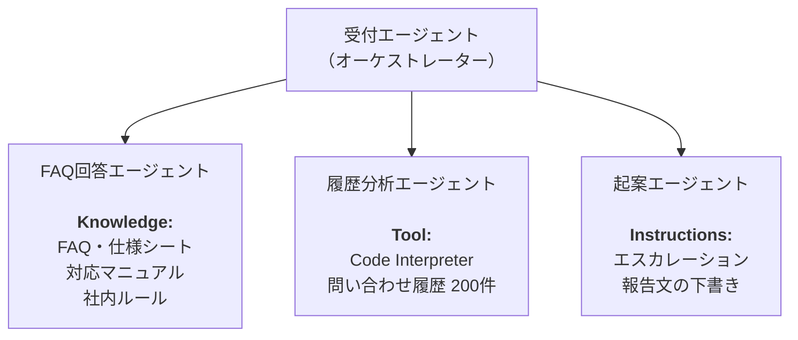

# Microsoft Foundry & GitHub Copilot ハンズオン

> Microsoft Foundry でエージェントを作り、社内文書をナレッジとして与え、GitHub Copilot でそれを呼び出すクライアントまで作るハンズオンです。

架空の日用消費財メーカー「サンライト株式会社 お客様相談室」を題材に、**一次対応エージェント** を段階的に育てていきます。

---

## 🎯 このハンズオンのゴール

- Microsoft Foundry で動くエージェントを、**自分の手で 1 体つくる**
- ナレッジを与えると回答が **根拠を持つ** ようになることを体感する
- ナレッジの品質が回答の品質を決めることを、**実際の矛盾** を通じて理解する
- **GitHub Copilot をエージェントとして使う** 感覚をつかむ

## 📚 Lab 一覧

| # | タイトル | 所要 | 内容 |
|---|------|------|---------|
| 1 | [Microsoft Foundry でエージェントを作る](labs/lab1-foundry-basics/README.md) | 30min | ポータル操作のみ。エージェント作成、モデル選択、Instructions |
| 2 | [ナレッジとマルチエージェント](labs/lab2-knowledge-and-multiagent/README.md) | 65min | File Search、Code Interpreter、Connected Agents |
| 3 | [GitHub Copilot でエージェントを呼び出す](labs/lab3-github-copilot/README.md) | 60min | エージェントモード、Copilot CLI、Issue → PR |

> 💡 **Lab 1 と Lab 2 はコードを書きません。** すべてブラウザ上の操作で完結します。エディタを使うのは Lab 3 からです。

## 🎬 シナリオ

| 項目 | 内容 |
|------|------|
| 企業 | サンライト株式会社（架空の日用消費財メーカー） |
| 部門 | お客様相談室 |
| 課題 | 問い合わせの一次対応に時間がかかり、担当者によって回答の質がばらつく |
| 扱う製品 | 衣料用液体洗剤「アクアクリア」／食器用洗剤「キュットフォーム」／ヘアケア「モイストヴェール」 |
| つくるもの | 一次対応を支援するマルチエージェント構成 |

### 最終的にできあがる構成



> ⚠️ **本ハンズオンで使用する企業名・製品名・文書・データは、研修のために作成した架空のものです。** 実在の企業・製品とは一切関係ありません。

## 📋 事前準備

講師付きのハンズオンでも、セルフラーニングでも利用できます。学習を始める前に、次の順序で準備してください。

1. **[Azure サブスクリプションと Foundry の事前設定](azure-setup.md)**: Azure 無料アカウントの案内、Azure Portal からの Foundry 作成、権限設定、モデルデプロイ
2. **[setup.md](setup.md)**: PC／Codespaces の準備、GitHub アカウントと GitHub Copilot Free（無償版）の登録・サインイン

利用可能な Azure／Foundry 環境がある場合は、作成し直す必要はありません。事前設定ページのチェックリストで権限とモデルデプロイを確認してください。Azure サブスクリプション と GitHub Copilot の無料枠は別です。

## 📁 リポジトリ構成

```
.
├── README.md                          # このファイル
├── setup.md                           # 事前準備
├── azure-setup.md                     # Azure／Foundry の作成・権限設定
├── troubleshooting.md                 # 共通トラブルシューティング
├── .gitignore                         # ローカルの認証情報・生成物を除外
├── .devcontainer/
│   └── devcontainer.json              # Codespaces の開発環境
└── labs/
    ├── data/                          # Lab 2 の各種マニュアル、ドキュメント、データと検証用質問リスト
    │   ├── 製品FAQ_*.docx
    │   ├── 製品仕様シート_*.pdf
    │   ├── 対応マニュアル.docx
    │   ├── 社内ルール.docx
    │   ├── 問い合わせ履歴.csv
    │   └── 検証用質問リスト.md
    ├── lab1-foundry-basics/
    │   └── README.md
    ├── lab2-knowledge-and-multiagent/
    │   └── README.md
    └── lab3-github-copilot/
        └── README.md
```

Lab 3 を Codespaces で進める場合は、[事前準備](setup.md#codespaces-を使う場合任意) を参照してください。

## 🚶 進め方

1. 各 Lab の README を **上から順に** 読み進めてください
2. 各手順の末尾にある **`✅ 成功確認`** で、自分の状態を確かめてください
3. つまずいたら、まず各 Lab 末尾の **トラブルシューティング** を確認してください
4. 解決しない場合は、[共通トラブルシューティング](troubleshooting.md) と公式ドキュメントを確認し、教材の問題はこのリポジトリの Issue で報告してください。講師付きで実施する場合はサポーターにも相談できます
5. 時間が余った方は、各所にある **「（任意）」** の演習に進んでください

> 💡 **完走が目的ではありません。** 特に Lab 2 の演習 2「ナレッジの質が、回答の質を決める」は、手を動かすより **起きたことの意味を考える** 時間にしてください。

## 🔗 参考リンク

- [Microsoft Foundry ドキュメント](https://learn.microsoft.com/ja-jp/azure/ai-foundry/)
- [Foundry Agent Service](https://learn.microsoft.com/ja-jp/azure/ai-foundry/agents/overview)
- [GitHub Copilot ドキュメント](https://docs.github.com/ja/copilot)
- [Microsoft Learn: AI エージェント ラーニングパス](https://learn.microsoft.com/ja-jp/training/)

---

## 📝 ライセンスと注意事項

- 本ハンズオンの教材は、研修目的で作成されたものです
- 登場する企業・製品・文書・データはすべて架空です
- 記載されている製品仕様・画面構成は、執筆時点（2026年10月）のものです
