# Lab 2: ナレッジとマルチエージェント

> Lab 1 で作った `CustomerSupportAssistantV1` に社内文書をナレッジとして追加し、回答の変化を確認します。さらに、受付役が専門エージェントへ振り分ける **マルチエージェント構成** を組み立てます。

セットアップ・演習の流れは [ルート README](../../README.md) を参照してください。

---

> ❗ **前提**: [Lab 1](../lab1-foundry-basics/lab1-foundry-basics.md) が完了し、`CustomerSupportAssistantV1` が作成済みであること。

## 🎯 このパートのゴール

- エージェントに **ナレッジ（File Search）** を追加し、回答が根拠を持つようになることを確認する
- 回答に **引用元** が表示される仕組みを理解する
- ナレッジの品質が回答の品質を決めることを、**実際の矛盾** を通じて体感する
- **Code Interpreter** でデータを集計・可視化させる
- **A2A（Agent2Agent）** で、受付役が専門エージェントに振り分ける構成を作る

## 📋 前提条件

| 項目 | 要件 | 確認方法 |
|------|------|---------|
| Lab 1 | 完了済み | エージェント一覧に `CustomerSupportAssistantV1` がある |
| 手順（Instructions） | Lab 1 の演習 1.4 の内容が保存済み | エージェント設定パネルで確認 |
| ナレッジファイル | このリポジトリから取得済み（9 ファイル） | 演習 1.1 で確認 |

## 📁 使用するファイル

このリポジトリの [labs/data](../data) フォルダには、次のファイルが入っています。

| ファイル | 形式 | 内容 |
|------|------|---------|
| `製品FAQ_アクアクリア.docx` | Word | 衣料用洗剤の Q&A 10 問（台帳形式） |
| `製品FAQ_キュットフォーム.docx` | Word | 食器用洗剤の Q&A 10 問（読み物形式） |
| `製品FAQ_モイストヴェール.docx` | Word | ヘアケアの Q&A 10 問（プレーン形式） |
| `製品仕様シート_アクアクリア.pdf` | PDF | 品番別の製品カルテ（A4 縦） |
| `製品仕様シート_キュットフォーム.pdf` | PDF | 全品番のマトリクス台帳（A4 横） |
| `製品仕様シート_モイストヴェール.pdf` | PDF | 節番号付きの技術資料 |
| `対応マニュアル.docx` | Word | エスカレーション基準、回答テンプレート、NG 表現 |
| `社内ルール.docx` | Word | 個人情報の取扱い、表現ガイドライン |
| `問い合わせ履歴.csv` | CSV | 2026年4月〜9月の問い合わせ 200 件 |

> 💡 **書式がバラバラなのは意図的です**: FAQ と仕様シートは、ブランドごとに書式も作成部署も異なる設定にしてあります。実際の企業で起きている状態を再現しています。この意味は演習 2 で扱います。

---

## 演習 1: ナレッジを追加する（20 分）

### 1.1 教材ファイルを確認する

#### 手順

1. GitHub のリポジトリ画面で **Code → Download ZIP** を選んで展開するか、リポジトリをクローンし、[labs/data](../data) フォルダを開く

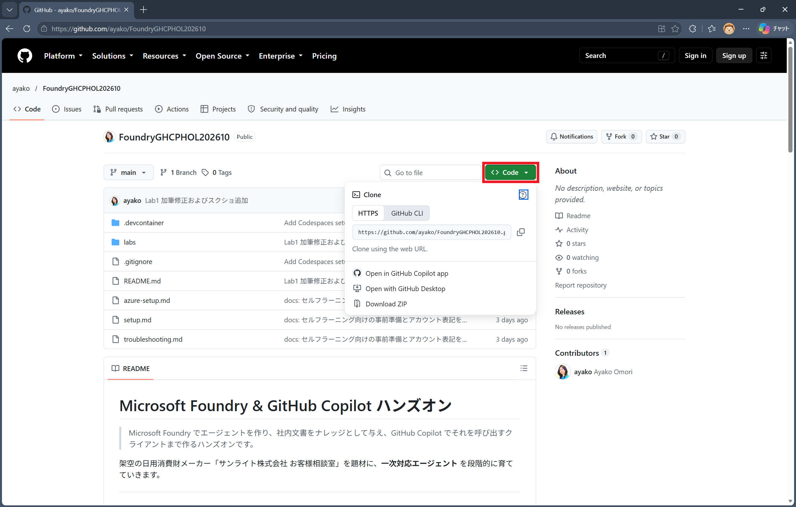

2. 上の表の 9 ファイルが揃っていることを確認する


**✅ 成功確認:**
- Word 5 ファイル、PDF 3 ファイル、CSV 1 ファイルが揃っている

### 1.2 ファイル検索を追加する

#### 手順

Lab 1 で作成した `CustomerSupportAssistantV1` にファイル検索を追加します。

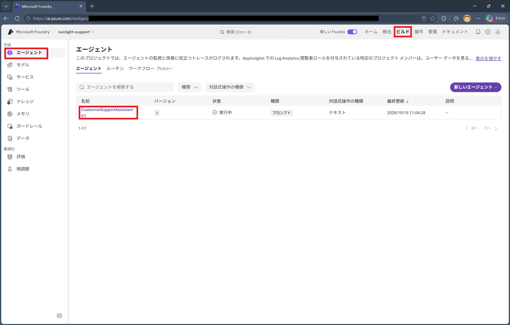

1. Foundry ポータルで **「エージェント」** を開き、`CustomerSupportAssistantV1` を選択する
2. デプロイが `gpt-5.4-mini` で、**「手順」**（Instructions）に Lab 1 の演習 1.4 の内容が設定されていることを確認する
3. 設定パネルを下にスクロールし、**「ツール」**（Tools）セクションの **「ファイルのアップロード」** をクリックする

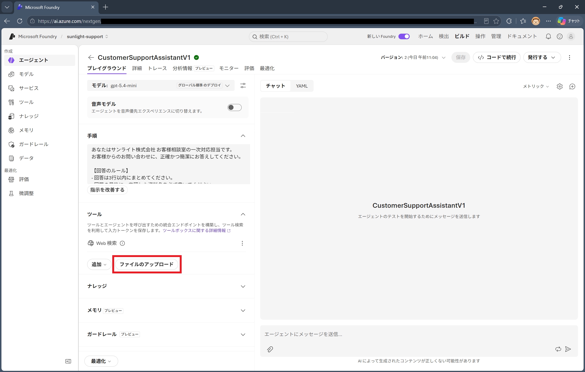


4. **「ファイルの添付」** ダイアログでベクターインデックス名に `sunlight-cs-knowledge` と入力する
5. ファイルの添付領域にドラッグアンドドロップするか、**「ファイルの参照」** から次の **8 ファイル** をまとめて選択する

```
製品FAQ_アクアクリア.docx
製品FAQ_キュットフォーム.docx
製品FAQ_モイストヴェール.docx
製品仕様シート_アクアクリア.pdf
製品仕様シート_キュットフォーム.pdf
製品仕様シート_モイストヴェール.pdf
対応マニュアル.docx
社内ルール.docx
```

6. **「アタッチ」** をクリックして処理の完了を待つ（1 分以上かかる場合があります）

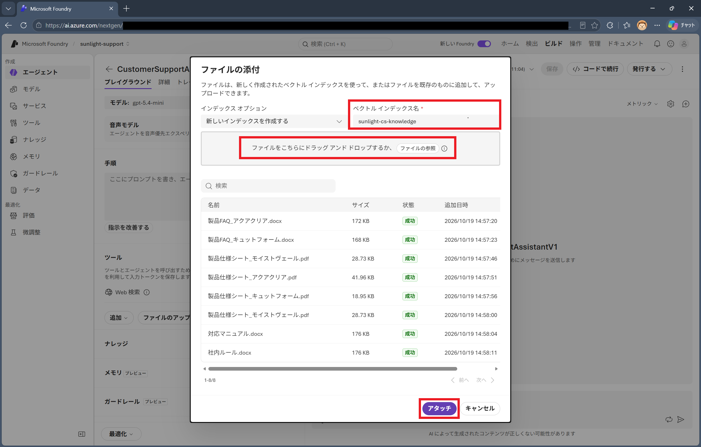


> ⚠️ **`問い合わせ履歴.csv` はここでは追加しません。** このファイルは演習 3 で Code Interpreter に使います。文書検索用のナレッジとは扱いが異なります。

**✅ 成功確認:**
- ツールセクションに **「ファイル検索」**（`sunlight-cs-knowledge`）が表示される
- ファイル検索の **「編集」** を開くと、`sunlight-cs-knowledge` に **8 ファイル** が登録され、各ファイルのステータスが **「完了」** になっている

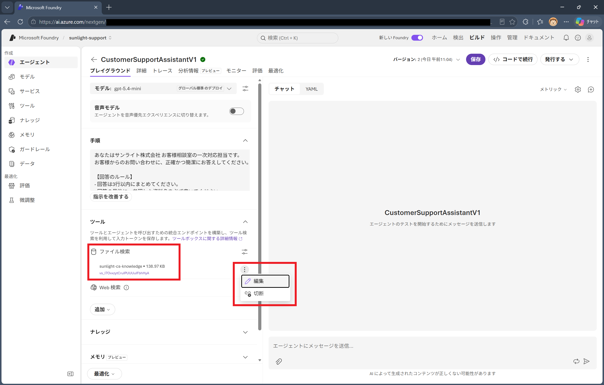

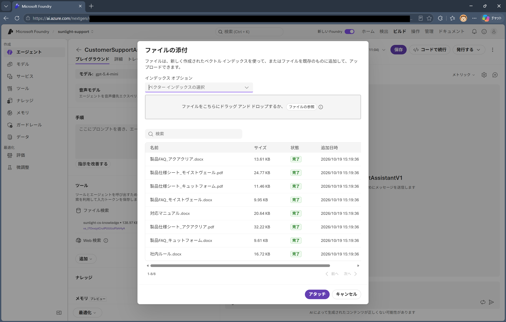


> 💡 **ファイル検索（File Search）とは**: アップロードした文書を自動的に分割・ベクトル化し、質問に関連する箇所だけを検索して回答に使う仕組みです。全文をモデルに渡すわけではないため、大量の文書でも動作します。

### 1.3 同じ質問をもう一度投げる

Lab 1 の演習 1.2 と **まったく同じ質問** を投げて、違いを確認します。

#### 手順

1. エージェントのプレイグラウンドで次の質問を送信する

```
アクアクリアは、ドラム式洗濯機でも使えますか？
```

**✅ 期待される挙動:**
- 具体的な根拠（適合表の内容）を含んだ回答が返る
- 回答の下部または文中に **引用元のファイル名** が表示される
- 手順（Instructions）のルールどおり、3 行以内かつ資料名付きで返る

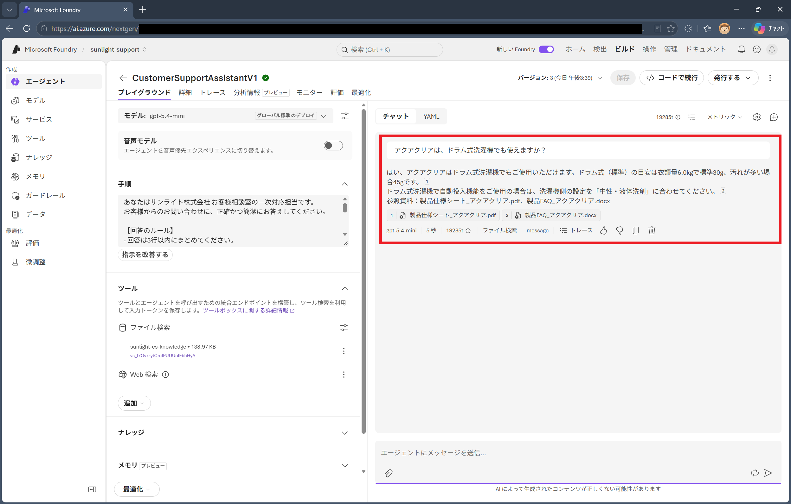


> 💡 **引用をクリックしてみてください**: 引用元の表示をクリックすると、どの文書のどの箇所を根拠にしたかを確認できます。「AI がそう言っている」ではなく「この資料にこう書いてある」と言えることが、業務利用では決定的に重要です。

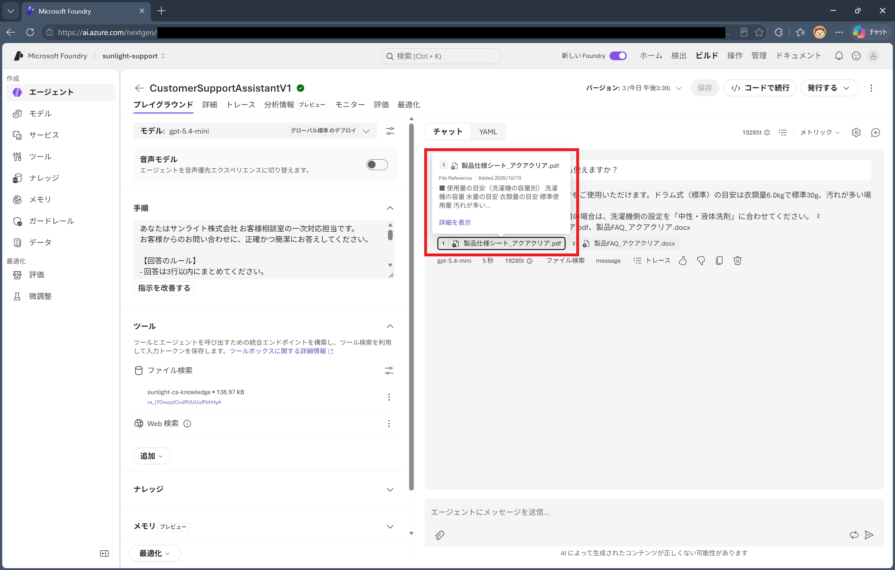


### 1.4 いろいろな質問を試す

次の質問を順に投げて、挙動を確認してください。

**A. ナレッジに答えがある質問**

```
容器の底に「K3 25A07」と書いてあります。これは何ですか？
```

```
キュットフォームの液性を教えてください。
```

```
洗剤が目に入ってしまいました。どうすればいいですか？
```

```
シルクのブラウスをアクアクリアで洗っても大丈夫ですか？
```

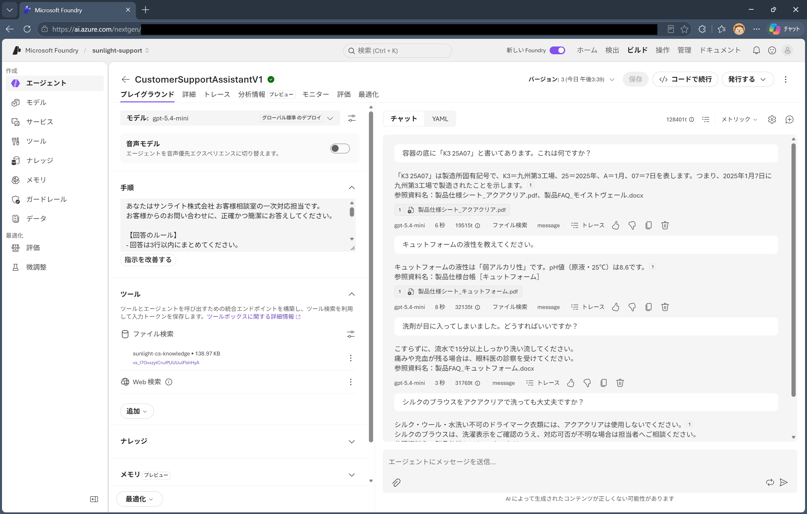

**B. ナレッジに答えがない質問**

```
アクアクリアの2027年春の新製品の発売日はいつですか？
```

```
九州第3工場の住所を教えてください。
```

```
競合A社の洗剤と比べて、洗浄力はどちらが上ですか？
```

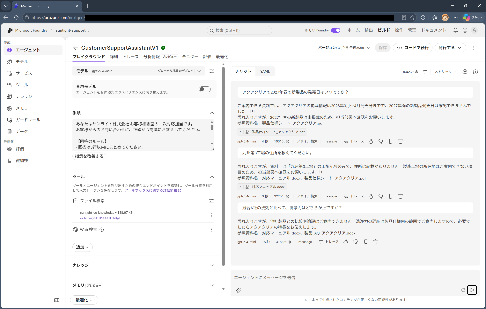

**✅ 期待される挙動:**

| 種別 | 期待される応答 |
|------|---------|
| A | ナレッジを根拠に具体的に回答し、引用元を示す |
| B | 推測せず、担当者へのエスカレーションを案内する |

> 💡 **B の 2 問目と 3 問目に注目**: 工場の所在地は `社内ルール.docx` で「回答不可」と定められており、他社比較は `対応マニュアル.docx` の NG 表現に該当します。**ナレッジに「答えてはいけないこと」が書いてあれば、それも守られます。**

---

## 演習 2: ナレッジの質が、回答の質を決める（10 分）

> ⚠️ **この演習が本日のハイライトです。** 手を動かすより、起きたことの意味を考える時間にしてください。

### 2.1 保管温度を聞いてみる

#### 手順

1. プレイグラウンドで次の質問を送信する

```
製品の保管温度の範囲を教えてください。
```

2. 返ってきた答えを控える
3. **新しい会話を開始**（画面上部の「+ 新しいチャット」）し、**同じ質問をもう一度**送信する

**✅ 観察してほしいこと:**
- 1 回目と 2 回目で、答えが変わることがある
- あるいは、複数の値が並記される
- あるいは、片方だけが断定的に返る

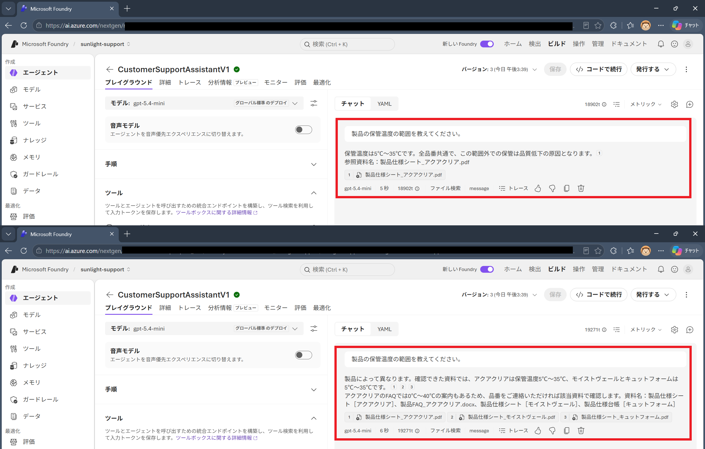


### 2.2 詰め替え後の使用期限を聞いてみる

#### 手順

```
詰め替えた後、どのくらいで使い切ればいいですか？
```

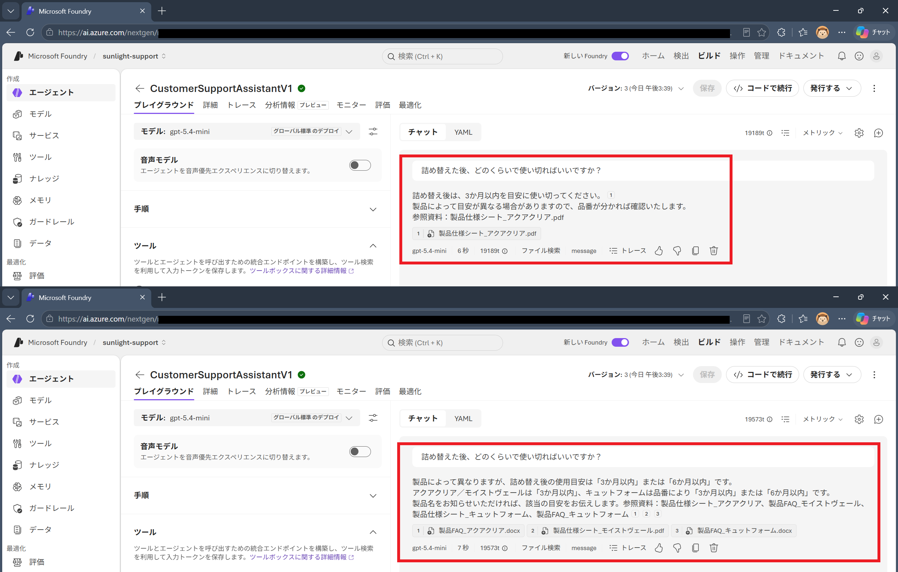


**✅ 観察してほしいこと:**
- 演習 2.1 と同様に、答えが安定しない

### 2.3 何が起きているかを確認する

教材のナレッジには、**意図的に矛盾が仕込んであります。**

| 項目 | 製品FAQ（Word） | 製品仕様シート（PDF） |
|------|------|---------|
| 保管温度 | 0℃〜40℃ | 5℃〜35℃ |
| 詰め替え後の使用目安 | 6 か月以内 | 3 か月以内 |

#### 手順

1. 教材ファイルの `製品FAQ_アクアクリア.docx` を開き、保管に関する記載を探す
2. `製品仕様シート_アクアクリア.pdf` を開き、保管条件の記載を探す
3. 両者が食い違っていることを自分の目で確認する

**✅ 成功確認:**
- 2 つの文書で、同じ項目に異なる値が書かれていることを確認できた

**ポイント解説:**

- エージェントは **どちらも「正しい社内文書」として扱います**。どちらが新しいか、どちらが正本かを判断する材料を持っていません
- したがって、**回答が揺れるのはモデルの性能問題ではありません**
- 実務では、次のような理由でこの状態が日常的に起きます
  - 部署ごとに文書を管理している
  - 改訂が片方にだけ反映された
  - 旧版が共有フォルダに残っている

> ⚠️ **持ち帰っていただきたい結論**
>
> **これは AI の精度の問題ではなく、ナレッジ側の版管理・整備の問題です。**
> エージェント導入の成否は、モデル選定よりも「何を読ませるか」の整備で決まります。

### 2.4 書式のばらつきも見てみる（任意）

3 つの FAQ は、それぞれ作成部署が異なる設定で、書式もバラバラです。

| ファイル | 設定上の作成部署 | 書式 |
|------|------|---------|
| `製品FAQ_アクアクリア.docx` | ホームケア部 | 3 列の表（台帳形式）、文書番号あり |
| `製品FAQ_キュットフォーム.docx` | キッチンケア部 | 章立ての読み物形式、文書番号なし |
| `製品FAQ_モイストヴェール.docx` | ビューティケア部 | Q. / A. のプレーン段落 |

次の質問を投げると、複数ファイルを横断して情報を集められるかが分かります。

```
3ブランドすべての詰め替え容量を、表にまとめてください。
```

> 💡 **書式が揃っていなくても読めます**: File Search は書式の違いに比較的強く、台帳でも読み物でも情報を拾えます。**問題は書式ではなく、内容の矛盾のほうです。**

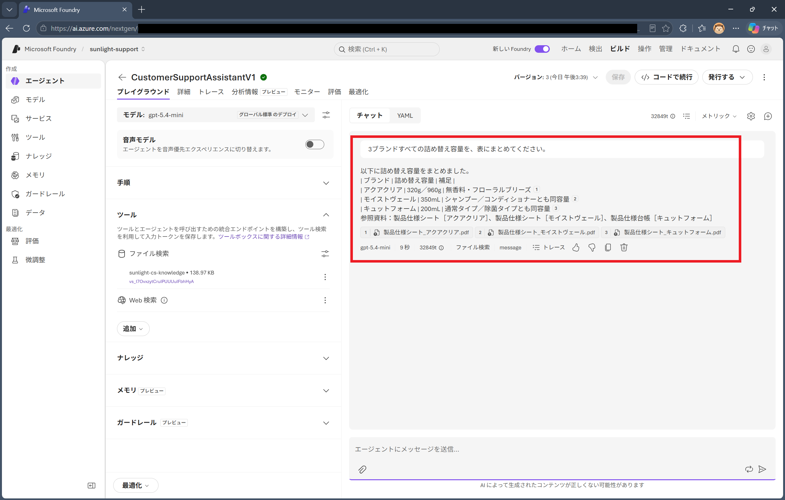

---

## 演習 3: データを分析させる（15 分）

文書検索だけでなく、**データを計算させる** こともできます。

### 3.1 コード インタープリターを有効にする

#### 手順

1. `CustomerSupportAssistantV1` の設定パネルの **「ツール」**（Tools）セクションで **「追加」** をクリックし、**「コード インタープリター」**（Code Interpreter）をオンにする

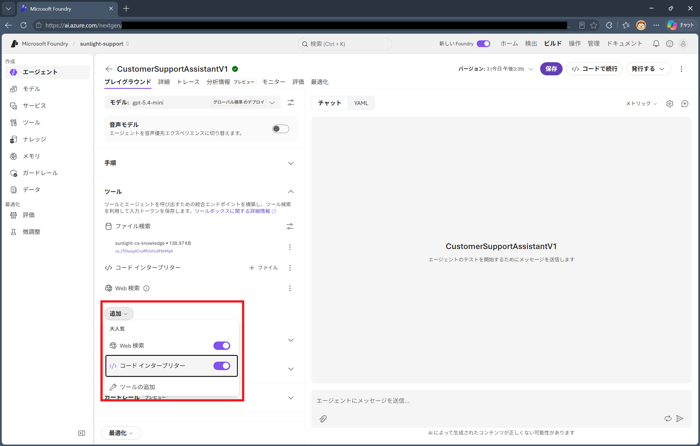

2. **「コード インタープリター」** の **「+ ファイル」** をクリックする

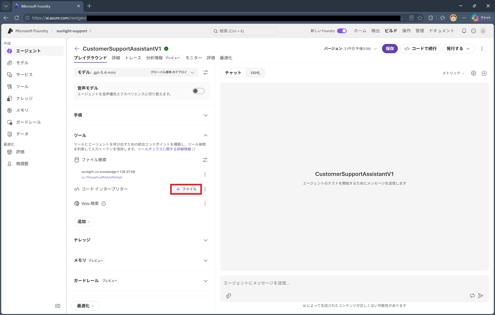

3. ファイルの添付領域から `問い合わせ履歴.csv` をアップロードし、**「アタッチ」** をクリックする

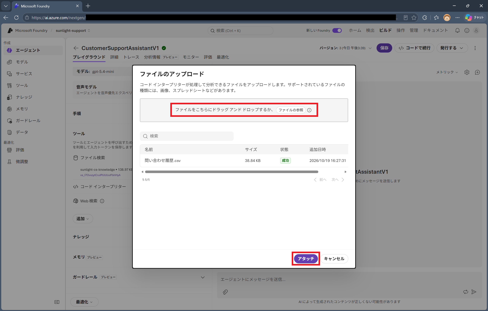


**✅ 成功確認:**
- ツールセクションに **「コード インタープリター」** が表示される
- 添付ファイルに `問い合わせ履歴.csv` が登録されている

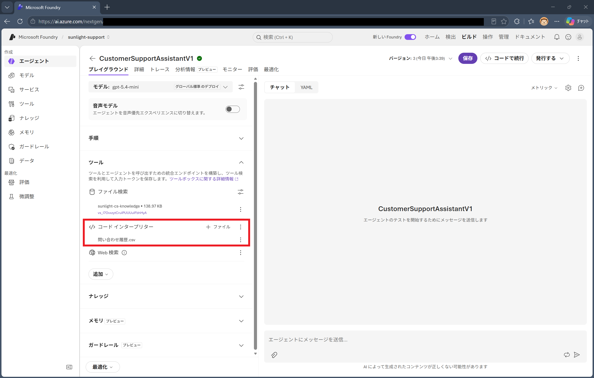

> 💡 **Code Interpreter とは**: エージェントが Python コードを書いて実行できるツールです。集計・グラフ作成・ファイル変換などを、その場で処理します。実行環境はサンドボックス化されており、外部には接続しません。

画面右上の **「保存」** をクリックして、変更を保存します。

### 3.2 集計させてみる

#### 手順

次の質問を順に送信します。

```
問い合わせ履歴から、月別の件数を集計してください。
```

```
2026年7月に問い合わせが急増しています。何が起きたか教えてください。
```

```
月別の問い合わせ件数を棒グラフにしてください。
```

**✅ 期待される挙動:**

| 質問 | 期待される回答 |
|------|---------|
| 月別集計 | 4月 30 件、5月 29 件、6月 29 件、**7月 50 件**、8月 31 件、9月 31 件 |
| 7月の急増理由 | 7月の 50 件のうち **25 件がキュットフォームの品質・不具合（ポンプ関連）** に集中している |
| 棒グラフ | 画像が生成され、7月に明確な山が見える |

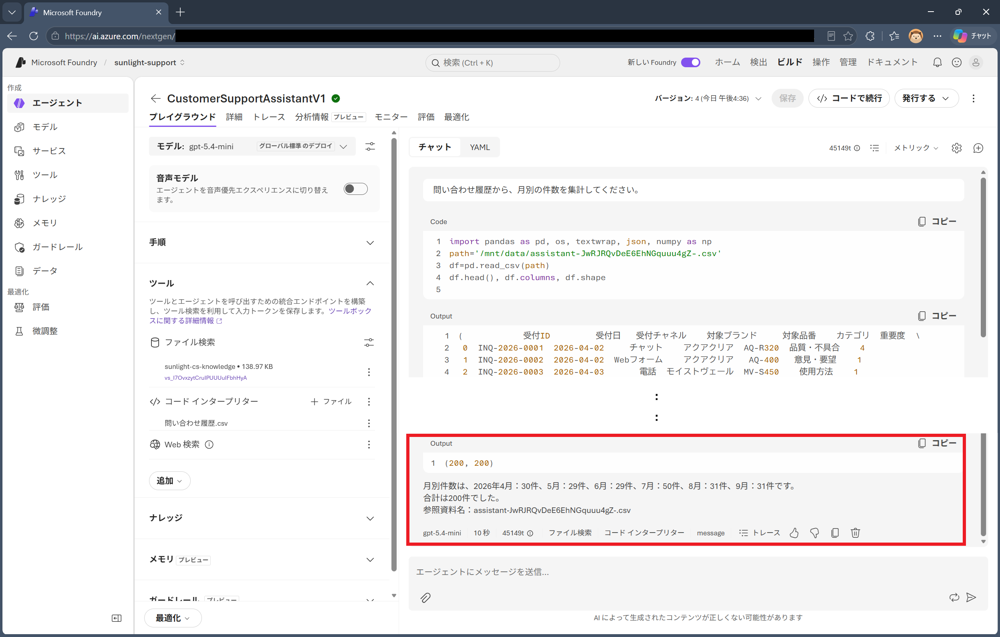
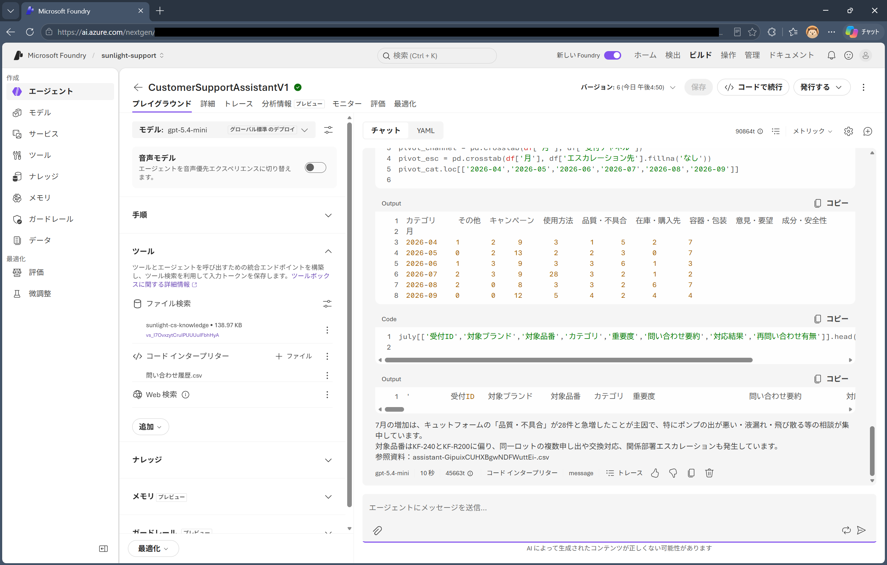
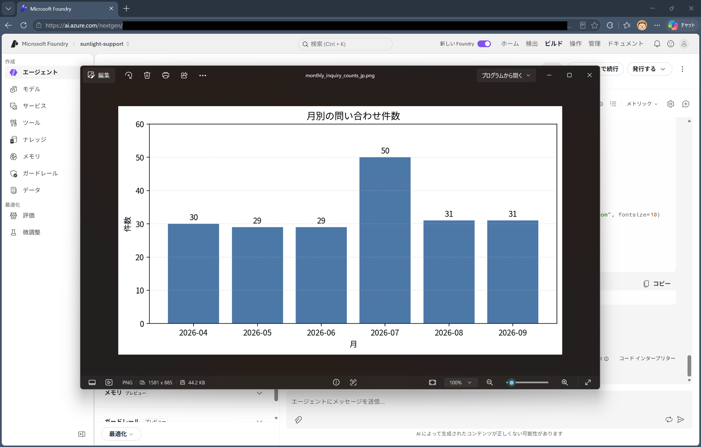


> 💡 **生成されたコードも見てください**: **どう計算したかが検証できる**ため、数字の根拠を説明できます。

### 3.3 さらに踏み込む（任意）

時間があれば、次のような質問も試してください。

```
重要度と対応所要日数に相関はありますか？
```

```
再問い合わせが発生している案件には、どんな共通点がありますか？
```

```
ブランド別・カテゴリ別のクロス集計表を作ってください。
```

---

## 演習 4: マルチエージェントを組む（20 分）

ここまでは 1 体のエージェントに全部やらせてきました。実務では、**役割ごとに分けた方が精度も保守性も上がります。**

### 4.1 完成形を確認する

これから、次の構成を作ります。

```
            ReceptionAgent（受付／オーケストレーター）
                        │
      ┌─────────────────┼─────────────────┐
      │                 │                 │
  FaqAnswerAgent     HistoryAnalysisAgent DraftingAgent
  （FAQ回答）         （履歴分析）         （起案）
  Knowledge:         Tool:              Instructions:
  FAQ・仕様シート     Code Interpreter    エスカレーション
  対応マニュアル       問い合わせ履歴       報告文の下書き
  社内ルール          200件
```

質問の種類を受付が判断し、適切な担当に渡します。

### 4.2 FAQ 回答エージェントを用意する

`CustomerSupportAssistantV1` はそのまま残し、FAQ 回答専用の `FaqAnswerAgent` を新しく作成します。

#### 手順

1. **「エージェント」** → **「+ 新しいエージェント」** をクリック
2. 次のように設定する

| 項目 | 値 |
|------|------|
| エージェント名 | `FaqAnswerAgent` |

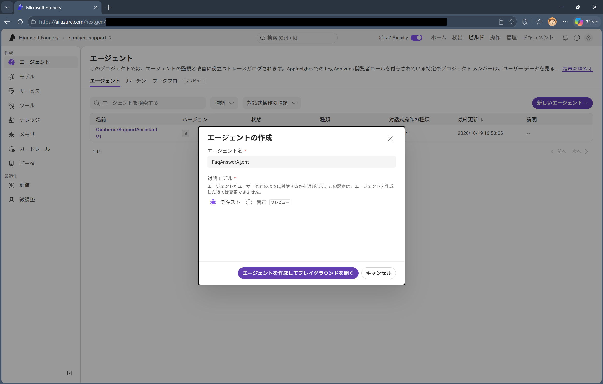

3. プレイグラウンドでモデルに `gpt-5.4-mini` を設定する
4. **「手順」**（Instructions）欄に、次の内容を **そのまま貼り付ける**

```text
あなたはサンライト株式会社 お客様相談室の一次対応担当です。
お客様からのお問い合わせに、正確かつ簡潔にお答えしてください。

【回答のルール】
- 回答は3行以内にまとめてください。
- 回答の最後に、参照した資料名を必ず書いてください。
- ナレッジに根拠がない場合は推測せず、担当者へのエスカレーションを案内してください。

【禁止事項】
- 医薬品的な効能効果の表現（「治る」「効く」など）は使わないでください。
- 「絶対に安全」「副作用は一切ない」などの断定的な表現は使わないでください。
- 他社製品との比較や論評はしないでください。
```

5. **「ツール」**（Tools）セクションの **「ファイルのアップロード」** をクリックする
6. **「インデックスオプション」** で演習 1.2 で作成した `sunlight-cs-knowledge` を選択し、**「アタッチ」** をクリックして適用する
7. **「保存」** をクリックする

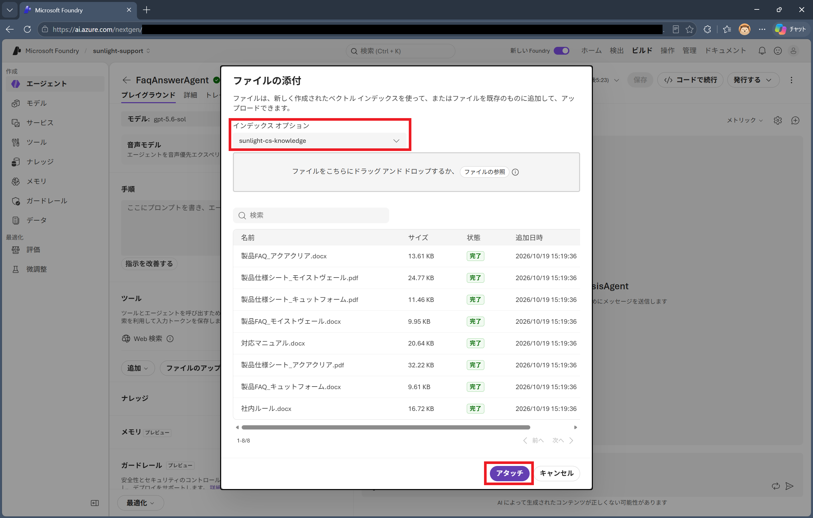


**✅ 成功確認:**
- `FaqAnswerAgent` にモデル、手順およびツール（ファイル検索）が設定されている

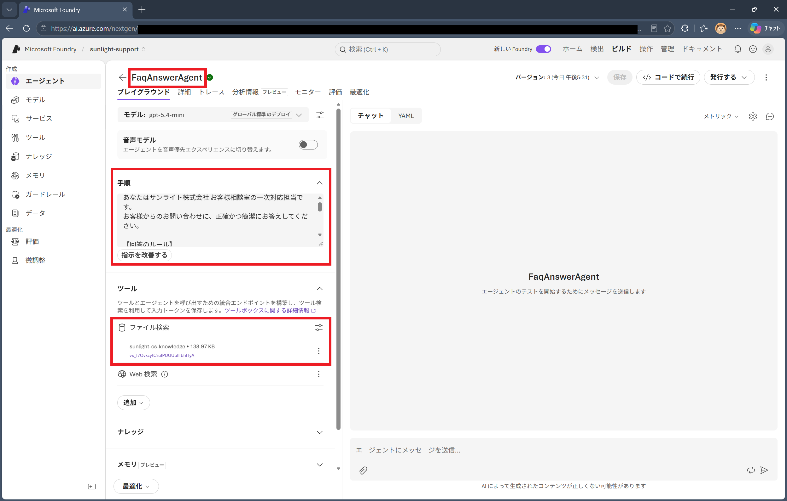


### 4.3 履歴分析エージェントを作る

#### 手順

1. **「エージェント」** → **「+ 新しいエージェント」** をクリック
2. 次のように設定する

| 項目 | 値 |
|------|------|
| エージェント名 | `HistoryAnalysisAgent` |
| デプロイ | `gpt-5.4-mini` |

3. **「手順」**（Instructions）に次を貼り付ける

```text
あなたはサンライト株式会社 お客様相談室の問い合わせデータを分析するアナリストです。

- 添付された問い合わせ履歴データを使って、件数・傾向・相関を分析してください。
- 集計結果を先に示し、そのあとに解釈を述べてください。
- 件数や日数は必ず具体的な数値で示してください。
- データに含まれていない情報を推測して答えないでください。
- 重要度は1が軽微、4が最重要です。
```

4. **「ツール」** セクションの **「追加」** → **「コード インタープリター」** を選択し、`問い合わせ履歴.csv` をアップロードする
5. **「保存」** をクリック

**✅ 成功確認:**
- プレイグラウンドで「7月の件数は？」と聞くと、50 件と答える

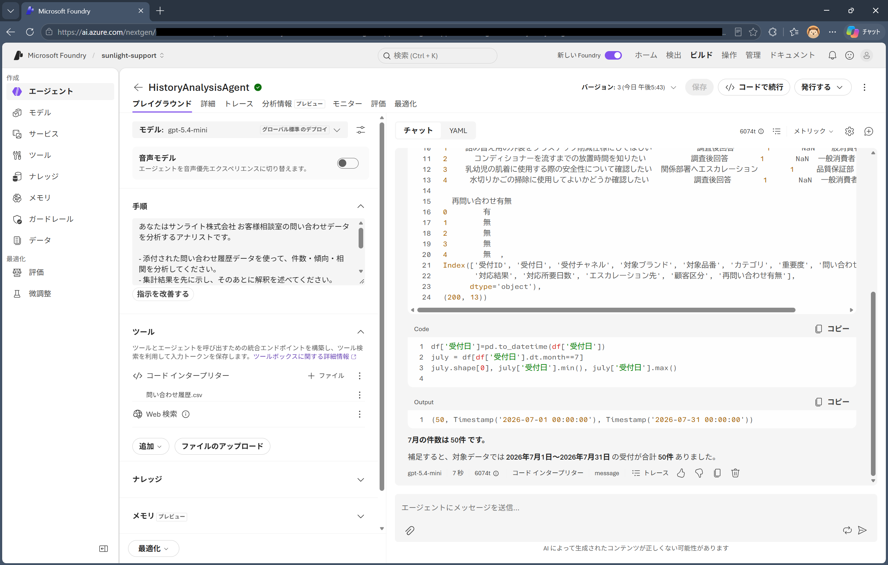

### 4.4 起案エージェントを作る

#### 手順

1. **「+ 新しいエージェント」** をクリック
2. 次のように設定する

| 項目 | 値 |
|------|------|
| エージェント名 | `DraftingAgent` |
| デプロイ | `gpt-5.4-mini` |

3. **「手順」**（Instructions）に次を貼り付ける

```text
あなたはサンライト株式会社 お客様相談室の記録・起案担当です。
オペレーターから受けた内容をもとに、関係部署へのエスカレーション報告文の下書きを作成します。

【報告文に必ず含める項目】
1. 件名
2. 受付日時（不明な場合は「YYYY-MM-DD」と記載）
3. お客様からの申し出内容（事実のみ）
4. 一次対応で確認した事項
5. エスカレーション理由と緊急度
6. 依頼事項

【ルール】
- 事実と推測を明確に分けて記述してください。
- 原因を断定する表現は使わないでください。
- お客様の個人情報は記載しないでください。
- 社内文書としての体裁を整えてください。
```

4. **「保存」** をクリック

**✅ 成功確認:**
- プレイグラウンドで「ポンプから液が出ないという申し出がありました。報告文を作ってください」と入力すると、6 項目を備えた下書きが返る

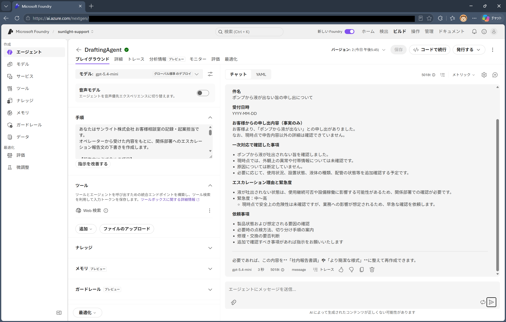

### 4.5 A2A を設定する

3 体の専門エージェントに **受信 A2A（Agent2Agent）** を有効化し、他のエージェントから発見・呼び出しできるように準備します。Foundry ポータルではまだ設定できないため、REST API を PowerShell または Bash から実行します。

#### 手順

1. ターミナルで Azure にサインインし、対象サブスクリプションを選択する

```text
az login
az account set --subscription "<サブスクリプションID>"
```

2. リポジトリのルートで **次の PowerShell または Bash のいずれか一方**を実行する。Foundry リソース名とプロジェクト名を実際の値に置き換えてください。プロジェクトのエンドポイントが `https://<リソース名>.services.ai.azure.com/api/projects/<プロジェクト名>` であることを確認します。

**PowerShell（Windows で推奨）**

[a2a-settings.ps1](script/a2a-settings.ps1) を実行します。

```powershell
$FoundryName = "<Foundryリソース名>"
$ProjectName = "<プロジェクト名>"

.\labs\lab2-knowledge-and-multiagent\script\a2a-settings.ps1 `
    -FOUNDRY_NAME $FoundryName `
    -FOUNDRY_PROJECT_NAME $ProjectName
```

**Bash（Azure Cloud Shell の Bash、Git Bash、WSL など）**

[a2a-settings.sh](script/a2a-settings.sh) を実行します。Bash 環境側にも Azure CLI と `curl` が必要です。

```bash
export FOUNDRY_NAME="<Foundryリソース名>"
export FOUNDRY_PROJECT_NAME="<プロジェクト名>"

bash labs/lab2-knowledge-and-multiagent/script/a2a-settings.sh
```

スクリプトは Azure CLI でアクセストークンを取得し、各エージェントに `PATCH /agents/<エージェント名>?api-version=v1` を送信します。設定内容は次のとおりです。

| 設定項目 | 内容 |
|------|------|
| `agent_card` | エージェントの説明、カードのバージョン、スキルの ID・名前・説明 |
| `agent_endpoint.protocol_configuration.responses` | Responses プロトコルを有効化（受信 A2A の前提） |
| `agent_endpoint.protocol_configuration.a2a` | 受信 A2A を有効化 |

> 💡 **カードの説明は役割を明確にします**: FAQ 回答、履歴分析、報告文の起案という 3 体の役割を登録します。この設定だけでは、エージェント同士の接続や自動振り分けは行われません。また、匿名公開ではなく Microsoft Entra ID 認証が必要です。

3. 各エージェントの `SUCCESS` が表示されたことを確認する。エラーで停止した場合は、エラーの内容とエージェント名・権限を確認し、解消してから再実行してください。

> 💡 今回使用したターミナルは、演習 4.7 でもそのまま引き続き使用します。

**✅ 成功確認:**
- 各エージェント（`FaqAnswerAgent`、`HistoryAnalysisAgent`、`DraftingAgent`）の **「詳細」** タブで、**「A2A プロトコル」** が **「アクティブ」** と表示される
- このとき表示される **「エンドポイント」**（URL）を 3 体分コピーし、ローカルに保存する

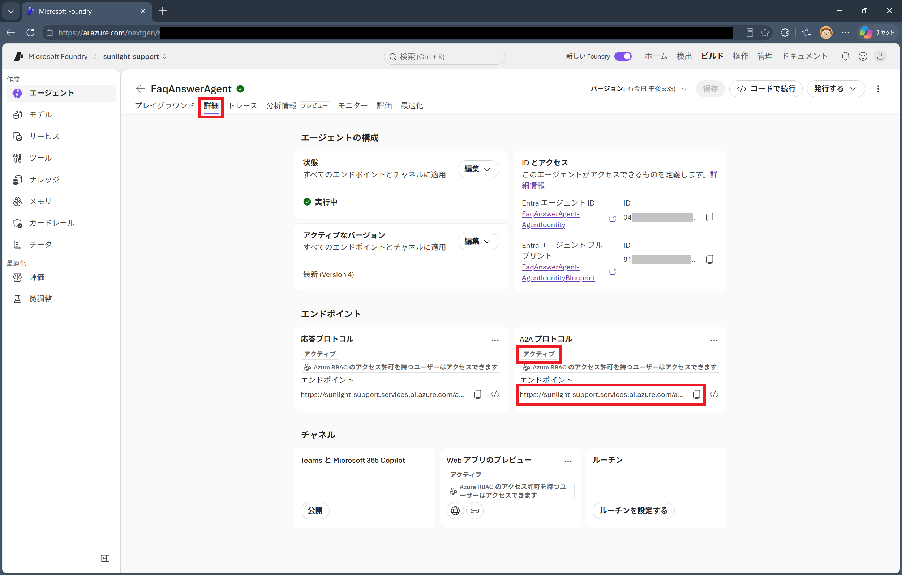


### 4.6 受付エージェントを作る

#### 手順

1. **「+ 新しいエージェント」** をクリック
2. 次のように設定する

| 項目 | 値 |
|------|------|
| エージェント名 | `ReceptionAgent` |
| デプロイ | `gpt-5.6-sol` |

> 💡 **受付だけ上位モデルにします**: 振り分けの判断を誤ると全体が破綻するため、オーケストレーターには判断力の高いモデルを割り当てるのが定石です。

3. **「手順」**（Instructions）に次を貼り付ける

```text
あなたはサンライト株式会社 お客様相談室の受付担当です。
オペレーターからの相談内容を読み、適切な担当エージェントに取り次いでください。

【振り分けのルール】
- 製品の仕様・使い方・成分・安全性・社内手順に関する質問
  → FaqAnswerAgent に渡してください。
- 問い合わせの件数・傾向・期間比較など、データの集計や分析が必要な質問
  → HistoryAnalysisAgent に渡してください。
- 関係部署への報告文・エスカレーション文書の作成依頼
  → DraftingAgent に渡してください。

【回答のルール】
- 担当エージェントから受け取った内容を、オペレーターに分かりやすく伝えてください。
- どの担当が回答したかを、回答の冒頭に1行で示してください。
- 判断に迷う場合は、どの担当に渡すべきか確認してください。
```

4. **「ツール」** セクションの **「追加」** → **「ツールの追加」** をクリック

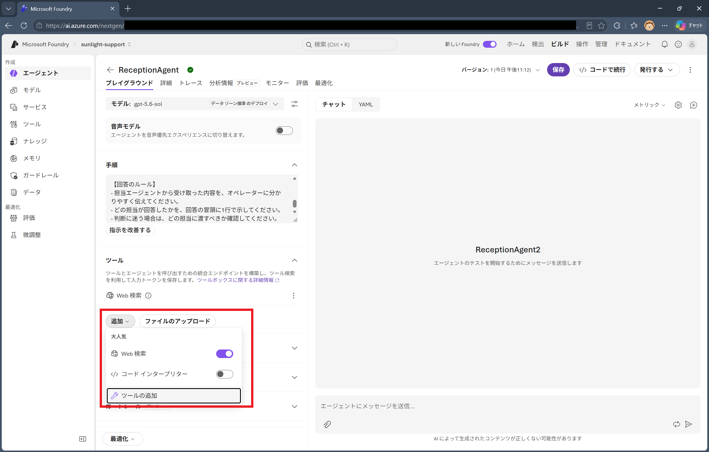

5. **「カスタム」** タブをクリックし、**「Agent2Agent (A2A)」** を選択して、**「作成」** をクリック

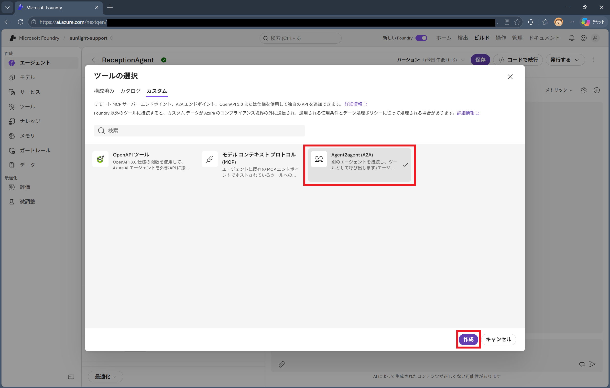

6. **「名前」** および **「A2A エージェントエンドポイント」** を入力する。エンドポイントは演習 4.5 でローカルに保存した URL です。

| 項目 | 値 |
|------|------|
| 名前 | `FaqAnswerAgent` |
| A2A エージェントエンドポイント | `https://YOUR_FOUNDRY_NAME.services.ai.azure.com/api/projects/YOUR_FOUNDRY_PROJECT_NAME/agents/FaqAnswerAgent/endpoint/protocols/a2a` |

7. **「接続」** をクリック

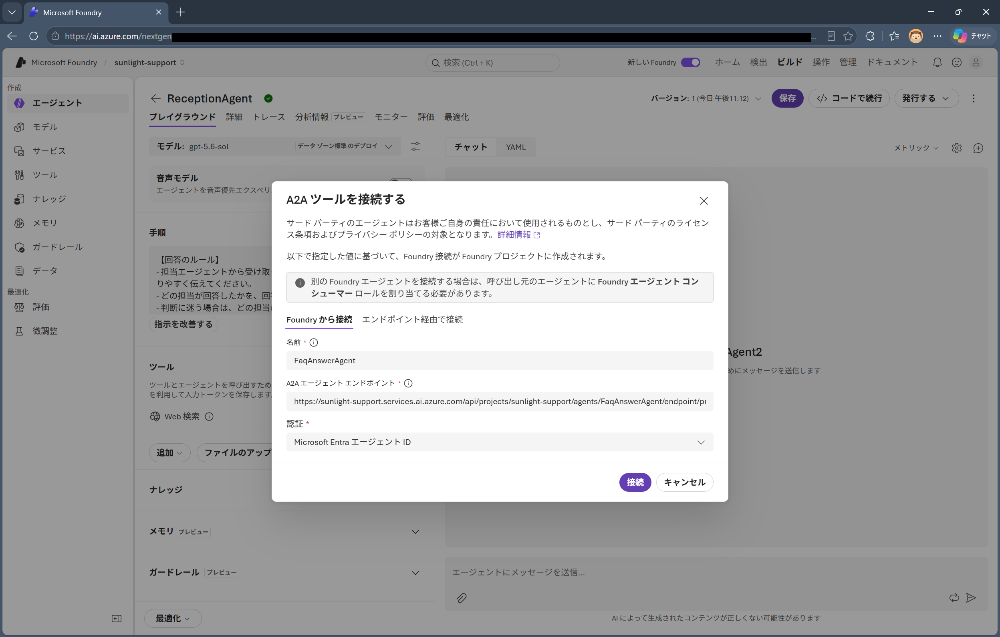

8. 残り 2 体のエージェントについても同様に A2A エンドポイントを追加する
9. `ReceptionAgent` のプレイグラウンドで **「保存」** をクリック
10. **「詳細」** タブをクリックし、**「Entra エージェント ID」** 欄の ID をコピーしてローカルに保存する

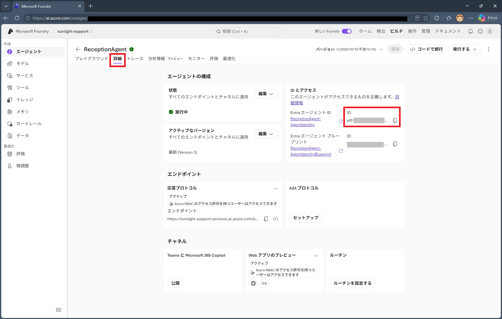

**✅ 成功確認:**
- `ReceptionAgent` に手順（Instructions）が設定され、ツールとして 3 体のエージェントの A2A エンドポイントが追加されている

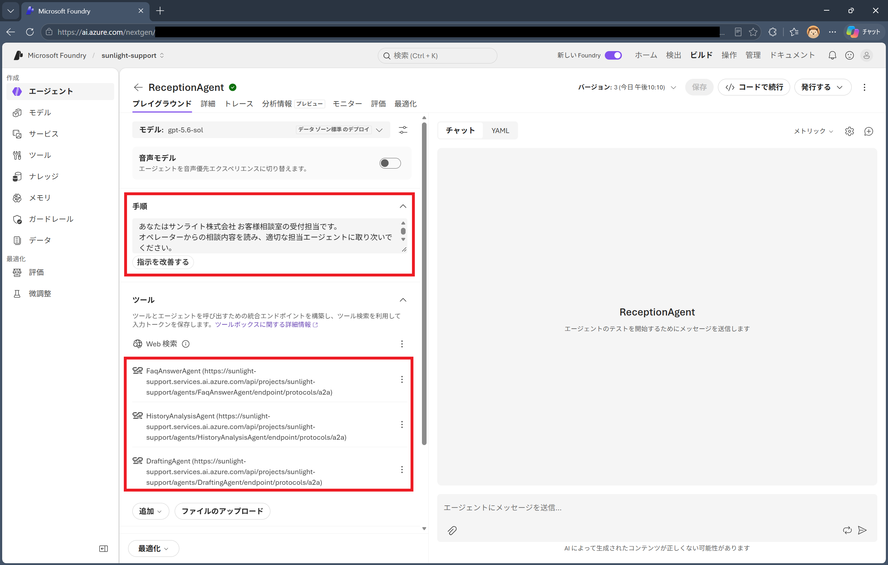

### 4.7 受付エージェントに権限を設定する

受付エージェントが専門エージェントの A2A エンドポイントを呼び出せるように、`ReceptionAgent` に **Foundry Agent Consumer** ロールを付与します。

#### 手順

1. `ReceptionAgent` の ID 情報から、呼び出しに使用するエージェント ID の **Microsoft Entra オブジェクト（プリンシパル）ID** を確認する。新しい Foundry エージェントでは `instance_identity` に指定された ID を使用します。

> ⚠️ **ID を取り違えないでください**: `ReceptionAgent` という名前、エージェントのリソース ID、アプリケーション（クライアント）ID ではありません。Microsoft Entra のサービスプリンシパルを識別するオブジェクト ID（GUID）を指定します。

2. 演習 4.5 で使用したターミナルで、**次の PowerShell または Bash のいずれか一方**を実行する。リソース名・プロジェクト名は、**呼び出し先の専門エージェントが属するプロジェクト**の値に置き換えます。

**PowerShell**

[permission.ps1](script/permission.ps1) を実行します。

```powershell
.\labs\lab2-knowledge-and-multiagent\script\permission.ps1 `
    -FOUNDRY_NAME "<Foundryリソース名>" `
    -FOUNDRY_PROJECT_NAME "<プロジェクト名>" `
    -CALLER_AGENT_OBJECT_ID "<ReceptionAgentのEntraオブジェクトID>"
```

**Bash**

[permission.sh](script/permission.sh) を実行します。

```bash
export FOUNDRY_NAME="<Foundryリソース名>"
export FOUNDRY_PROJECT_NAME="<プロジェクト名>"
export CALLER_AGENT_OBJECT_ID="<ReceptionAgentのEntraオブジェクトID>"

bash labs/lab2-knowledge-and-multiagent/script/permission.sh
```

スクリプトは選択中のサブスクリプションから Foundry リソースを取得し、対象プロジェクトのスコープで `Foundry Agent Consumer`（ロール ID: `eed3b665-ab3a-47b6-8f48-c9382fb1dad6`）を割り当てます。これにより、受付エージェントはそのプロジェクト内のエージェントエンドポイントへアクセスできるようになります。

**✅ 成功確認:**
- ロール割り当ての結果と `SUCCESS: Foundry Agent Consumer assigned.` が表示される

> 💡 **権限の反映には時間がかかる場合があります。** 割り当て直後に 403 が出る場合は、反映を待ってから再確認してください。


### 4.8 振り分けをテストする

#### 手順

**受付エージェント（`ReceptionAgent`）のプレイグラウンド**で、次の 3 つを順に送信します。

```
詰め替えの保管期限は？
```

```
先月いちばん多かった問い合わせカテゴリは？
```

```
ポンプから液が出ないという申し出がありました。品質保証部にエスカレーションしたいので報告文を作ってください。
```

**✅ 期待される挙動:**

| 質問 | 振り分け先 | 応答の特徴 |
|------|------|---------|
| 詰め替えの保管期限 | FaqAnswerAgent | ナレッジを引用して回答 |
| 先月最多のカテゴリ | HistoryAnalysisAgent | 具体的な件数を示す |
| 報告文の作成 | DraftingAgent | 6 項目の下書きが返る |

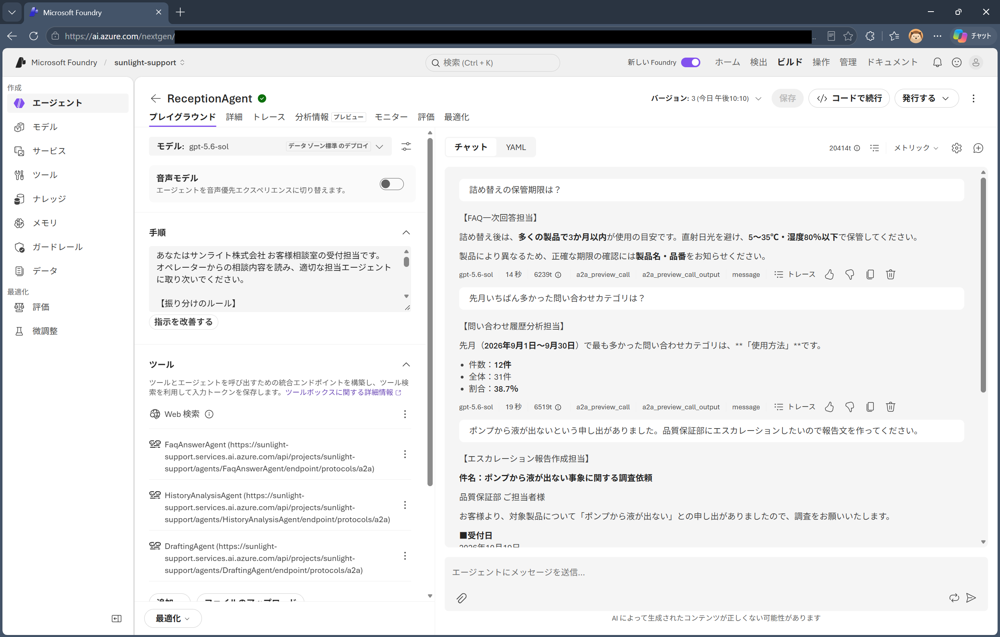

> 💡 **うまく振り分けられないときは**: 受付エージェントの手順（Instructions）と、接続時の「説明」欄を見直してください。**表現が抽象的だと迷います。** 「データの集計」「報告文の作成」のように、動詞を具体的に書くと安定します。

### 4.9 振り分けを崩してみる（任意）

意図的に誤動作させると、仕組みの理解が深まります。

**試してみる例:**

1. 接続した `HistoryAnalysisAgent` の **説明欄を空にする** → 集計質問が FAQ 担当に流れることがある
2. 受付の手順（Instructions）から **振り分けルールのブロックを削除する** → 判断が不安定になる
3. **どちらとも取れる質問** を投げてみる

```
7月に多かったポンプの不具合について、製品仕様も含めて教えてください。
```

> 💡 **3 の質問は、本来 2 つの担当にまたがります。** 受付がどう処理するかを観察してください。複数の担当を順に呼ぶ場合もあります。

---

## 📝 まとめ

| やったこと | 使った機能 |
|------|------|
| 社内文書 8 ファイルをナレッジ化した | ナレッジ（File Search） |
| 回答に引用元が付くことを確認した | ファイル検索の引用 |
| ナレッジの矛盾が回答を揺らすことを体感した | — |
| 200 件のデータを集計・可視化させた | コード インタープリター |
| 役割ごとに 3 体のエージェントを作った | エージェント |
| 専門エージェントの受信 A2A を有効化した | REST API、エージェントカード |
| 受付役から専門エージェントを呼び出した | A2A |

**この Lab で分かったこと:**

- ナレッジを与えると、回答は **根拠を持つ** ようになる
- ただし **ナレッジが矛盾していれば、回答も矛盾する**
- 1 体に全部やらせるより、**役割で分けたほうが精度も保守性も上がる**

## 🔗 参考リンク

- [Foundry Agent Service のツール一覧](https://learn.microsoft.com/ja-jp/azure/ai-foundry/agents/how-to/tools/overview)
- [ファイル検索（File Search）](https://learn.microsoft.com/ja-jp/azure/ai-foundry/agents/how-to/tools/file-search)
- [コード インタープリター](https://learn.microsoft.com/ja-jp/azure/ai-foundry/agents/how-to/tools/code-interpreter)
- [受信 A2A の有効化とアクセス権の設定](https://learn.microsoft.com/azure/foundry/agents/how-to/enable-agent-to-agent-endpoint)

---

## 🚨 トラブルシューティング

### ファイルのアップロードが「処理中」から進まない

**原因**: ファイルサイズが大きい、または同時アップロード数が多い。

**解決方法**:
1. 2〜3 分待つ（PDF は Word より時間がかかります）
2. 画面を再読み込み（F5）してステータスを確認する
3. それでも進まない場合は、ファイルを 2〜3 個ずつに分けてアップロードし直す

### 回答に引用元が表示されない

**原因**: ナレッジを参照せずに、モデルの一般知識だけで答えている。

**解決方法**:
1. 質問が具体的すぎないか確認する（「洗剤について教えて」では参照されにくい）
2. 製品名（アクアクリアなど）を含めて質問する
3. 手順（Instructions）に次の 1 行を追加する

```text
回答は必ずナレッジの内容に基づいて行い、参照した資料名を明記してください。
```

### コード インタープリターが CSV を読めない

**原因**: 文字コードの問題、またはファイルがナレッジ側に登録されている。

**解決方法**:
1. `問い合わせ履歴.csv` が **「ツール」→「コード インタープリター」** に添付されているか確認する（ナレッジ側ではありません）
2. エージェントに次のように指示する

```
問い合わせ履歴.csv を UTF-8 として読み込んでから集計してください。
```

### 受付エージェントが振り分けず、自分で答えてしまう

**原因**: 手順（Instructions）の振り分けの指示が弱い、または接続エージェントの説明が不足している。

**解決方法**:
1. 接続時の **「説明」** 欄が空になっていないか確認する
2. 受付の手順（Instructions）の末尾に次を追加する

```text
質問には自分で直接答えず、必ずいずれかの担当エージェントに取り次いでください。
```

### 接続エージェントの応答が返ってこない / 非常に遅い

**原因**: 連鎖的に複数のエージェントを呼んでいる、またはレート制限。

**解決方法**:
1. 1 分ほど待つ（3 体を順に呼ぶ場合、時間がかかります）
2. 接続エージェントの数を一時的に 1 つに減らして切り分ける
3. 受付のデプロイを `gpt-5.6-sol` から `gpt-5.4-mini` に変更して再試行する

### 「同じ質問なのに毎回答えが違う」

**原因**: 演習 2 で扱った **ナレッジの矛盾** が原因である可能性があります。

**解決方法**: これは不具合ではありません。演習 2.3 を読み返してください。実務では、参照する文書の正本を 1 つに絞ることで解消します。
